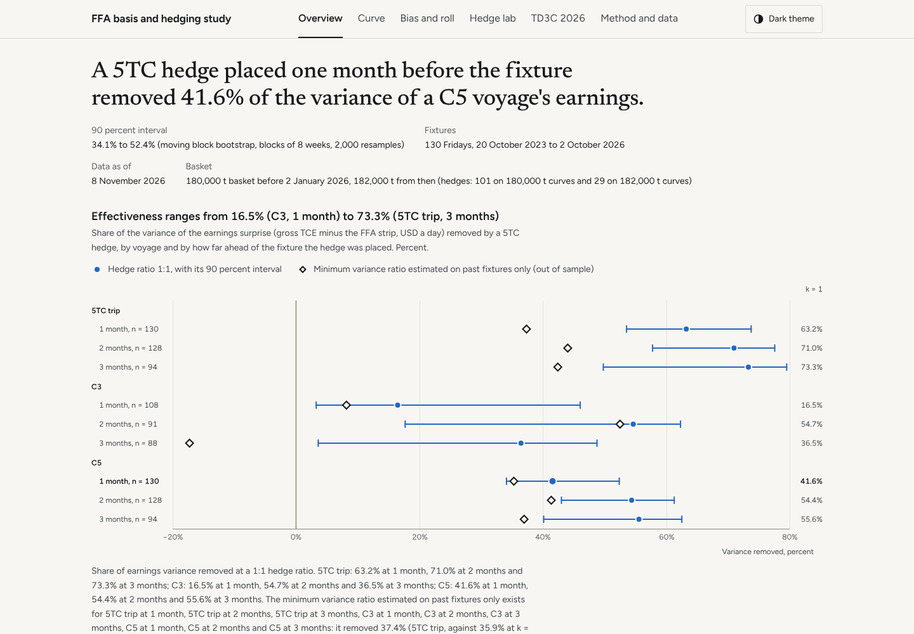
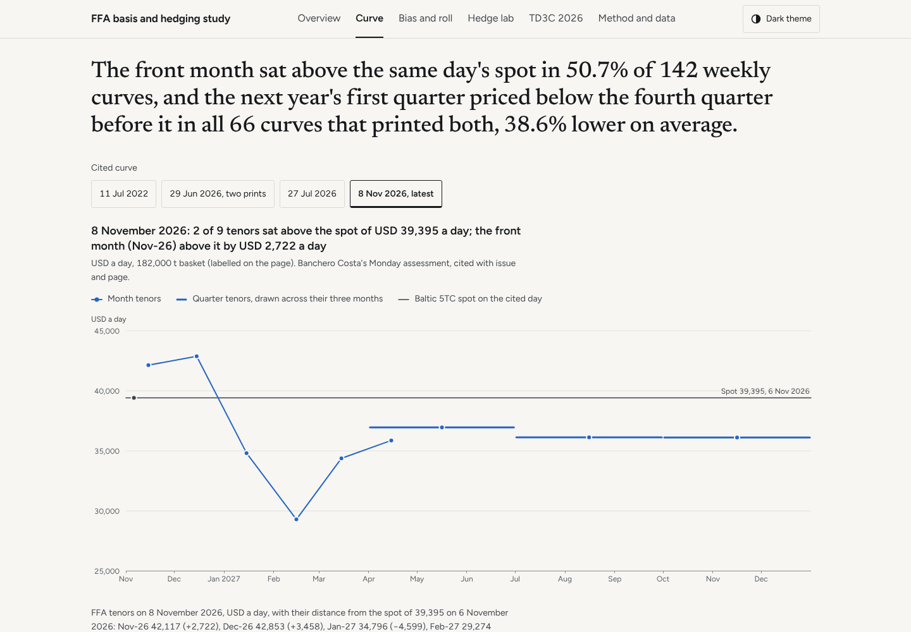
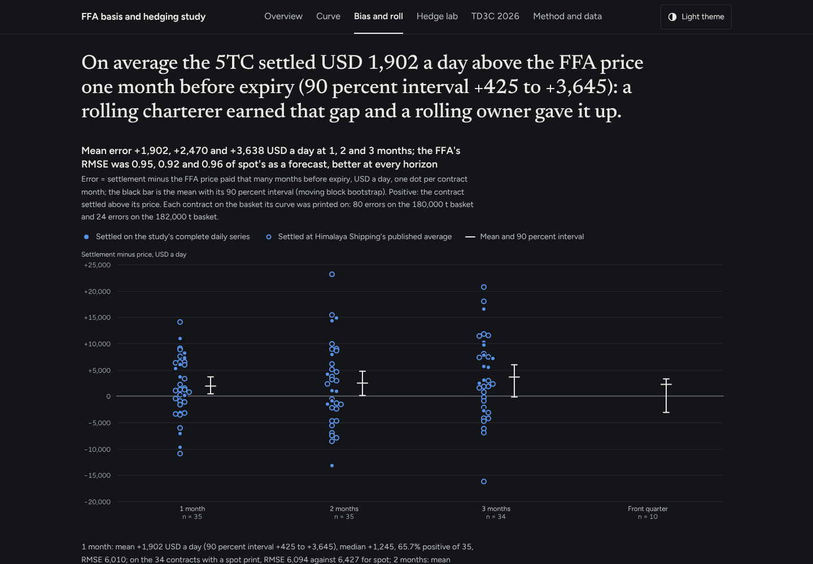
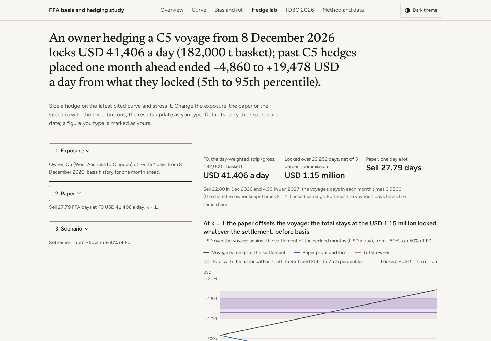
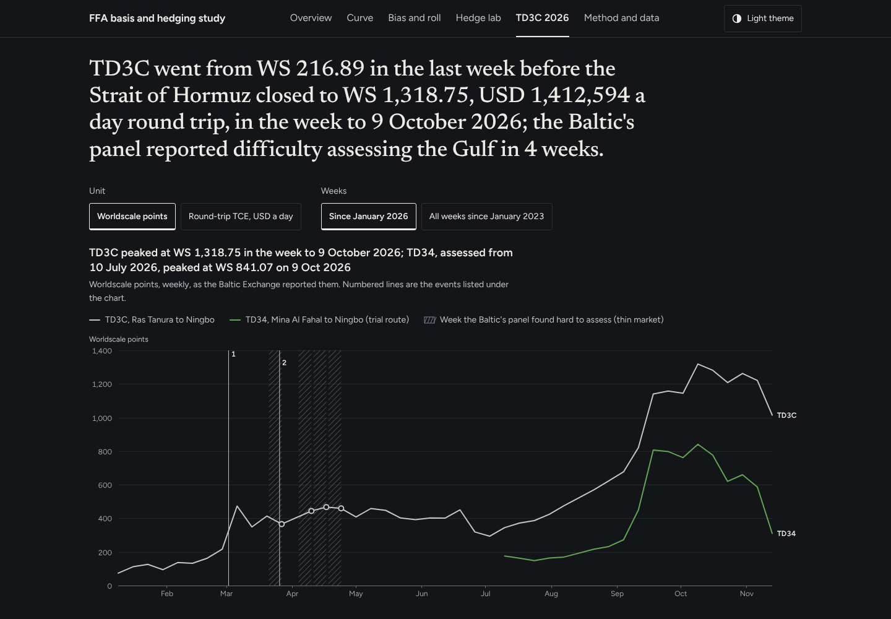
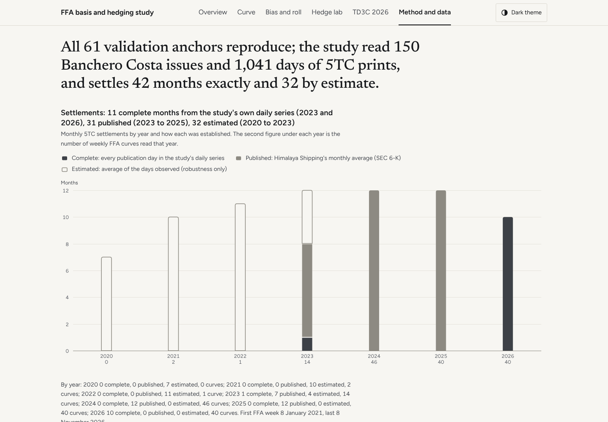
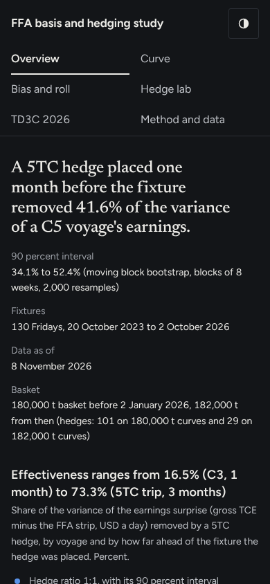

# FFA basis and hedging study: Capesize 5TC and TD3C

> Sets the Baltic's Capesize 5TC and TD3C spot assessments against the forward freight agreement (FFA) curve
> every week the public record allows, measures how often the curve sits in contango and what rolling it costs,
> and tests how much of a physical voyage's earnings uncertainty a paper hedge removes, and where the basis it
> leaves comes from.

**Live site:** https://nathancouturier.github.io/ffa-basis-hedging-study/

**Research note:** [`FFA-Basis-Hedging-Study-Research-Note.pdf`](FFA-Basis-Hedging-Study-Research-Note.pdf).

The question a freight desk asks of its hedge: if an owner (or a charterer) sells (buys) 5TC paper one, two or
three months before fixing a Capesize voyage, how much of the uncertainty in what the voyage earns against the
forward does the paper take away, what does the curve's shape cost a hedger who rolls, and what is left? The
voyages are a trip at the day's 5TC, a C3 Tubarao to Qingdao voyage and a C5 West Australia to Qingdao voyage,
priced with the voyage engine of [voyage-tce-model](https://nathancouturier.github.io/voyage-tce-model/), whose
Paper view this study extends from single dates to every week. TD3C, the Middle East Gulf to China VLCC route, is
followed through the 2026 closure of the Strait of Hormuz.

---

## What the study cannot do

Read this part first.

- **It is a hedging study, not a forecast or a strategy.** There is no signal, no position sizing and no profit
  and loss presented as a strategy. Forward bias and roll cost are costs and premiums a hedger faces, reported as
  such.
- **The daily 5TC is public in full only from January 2026.** Before that, the republished daily reports that the
  build environment can reach cover part of the days. A month's settlement is the study's own average only when
  every publication day is printed in public (July 2023 and January to October 2026); otherwise it is the monthly
  average Himalaya Shipping published in its SEC filings (May 2023 onwards), which agrees with every complete month
  to within a dollar; months before May 2023 have only partial averages and enter the robustness checks alone.
- **The forward curve is one broker's weekly assessment, and only from September 2023.** Banchero Costa's Monday
  Capesize FFA assessments, as Hellenic Shipping News republishes them. Partway through its archive that site began
  answering the build's requests with a browser challenge, which the study does not get around: the curve is
  weekly from September 2023 to November 2026, with three dated curves before it (January and July 2021, July
  2022). The hedged fixtures therefore start in October 2023, about three years of weekly fixtures, and the
  intervals are wide. The next issue's previous-week column is a re-assessment that differs from the first print
  by a median of about 3 percent; the study uses first prints and shows the latest as a sensitivity.
- **Some reports were read by OCR.** More than half of the issues read have at least one table in fonts that
  cannot be read as text. Those tables were read by OCR, and a row is kept only if it reproduces its own printed
  week-on-week change (or, for bunkers, the printed spread between grades). Pages that repeat the previous
  issue's figures under new dates are left out.
- **Voyage earnings are estimates, not fixtures.** C3 and C5 TCEs come from the voyage engine with the Baltic's
  standard ship of the date and that week's Singapore bunkers; port charges and loading time at the port's scale
  have no public figure and are left out, so the level of the route basis is overstated while its variability,
  which drives the hedge results, is not. No route (C3, C5) FFA is used: a voyage hedged with 5TC paper carries
  route basis by construction.
- **TD3C in dollars a tonne is approximate.** The Baltic publishes TD3C weekly in Worldscale in the reports the study
  reads. Worldscale flat rates are licensed and never stated here; the dated public pairs that would imply one do
  not agree in 2026 (prints four days apart in a market that moved by a fifth in a week), so 2026 stays in
  Worldscale and the dollar case studies and statistics use Breakwave's bi-weekly dollar prints, a month settled
  at the average of one or two prints. Weeks in which the Baltic wrote that its panellists had difficulty
  assessing Gulf loadings are marked.
- **The literature could not be opened.** Publishers' and repositories' hosts are refused by the build
  environment, so no published result (Ederington 1979; Kavussanos and Nomikos 2000; Alizadeh and Nomikos 2009) is
  compared; Ederington's measure is reported for the reader to set beside them.
- **Amplify's live holdings are captured only by the scheduled refresh.** Their pages draw from a host the build
  environment refuses; the SEC quarter-end marks carry the history.

## The finding

<!-- finding:start -->
**Data to 8 November 2026.**

1. A 5TC hedge placed one month ahead removed 41.6% of the variance of a C5 voyage's earnings against the forward (90 percent interval 34.1% to 52.4%; 130 weekly fixtures, 20 October 2023 to 2 October 2026), 63.2% for a trip at the day's 5TC and 16.5% for a C3 voyage. A ratio estimated only from past fixtures removed 35.3% against 36.2% at one for one on the same 72 fixtures.
2. What the hedge leaves is route and timing basis: route basis carries 55% of the variance of the hedged C5 result and timing basis 46%. Size basis carries 0%: from 2 January 2026 the Baltic derives the 180,000 t basket from the 182,000 t one at a fixed USD 3,503 a day, so a 182,000 t ship hedged with 180,000 t paper carries a constant, not a risk.
3. The 5TC settled on average USD 1,902 a day above the FFA price one month before expiry (35 contracts, October 2023 to October 2026, each on the basket its curve was printed on, 180,000 t before 2026 and 182,000 t in 2026; 90 percent interval +425 to +3,645): a rolling charterer earned that gap and a rolling owner gave it up.
4. The front month stood above the same day's spot in 50.7% of 142 weekly curves, and the next year's first quarter priced below the fourth quarter before it in 100% of the 66 curves that printed both, 38.6% lower on average.
5. TD3C went from WS216.89 in the week to 27 February 2026, the last before the Strait of Hormuz closed, to WS1,318.75 and a round-trip TCE of USD 1,412,594 a day in the week to 9 October 2026. An owner who sold one cargo a month at Amplify's quarter-end marks gave the windfall up on paper and realised 96%, 102%, 94% and 42% of what the marks of 30 September 2025 to 30 June 2026 locked (approximate, from Breakwave's dollar prints); the 30 June 2026 hedge fell short because September 2026's cargo was fixed at the month's first print, USD 136.98 a tonne, while the paper settled near USD 186.21: timing basis inside the month.
<!-- finding:end -->

## What it does

- **A panel built from public documents.** The Banchero Costa weekly reports Hellenic Shipping News served to
  the build (curves, Friday spot, C3, C5 and bunkers), every Baltic weekly tanker and bulk report since 2023 and 2021,
  every Amplify Commodity Trust 10-Q and 10-K since 2018 (BDRY and BWET quarter-end FFA marks), Himalaya
  Shipping's monthly 5TC averages, Breakwave's tanker reports, and the daily 5TC from handybulk.com and Reuters as
  republished. A fetcher reads each host's robots.txt, waits between requests, and records every document's URL,
  retrieval time and sha256 in `data/raw/manifest.json`.
- **Contract conventions applied exactly.** Settlement on the average of every publication day; the 180,000 t
  and 182,000 t baskets with their weights by period and the fixed USD 3,503 difference from 2 January 2026;
  gross time charter hire against net voyage TCEs; hedges sized in days at the net share, from the fixture date,
  month by month; TD3C in tonnes; owners short, charterers long. Each rule with its page in
  [`docs/methodology.md`](docs/methodology.md).
- **Curve shape, bias and roll cost.** Front month against spot, adjacent month and quarter spreads, contango and
  backwardation by year and calendar month, the first-quarter discount, slope against the spot level; forecast
  errors 1, 2 and 3 months before expiry with block bootstrap intervals and against a naive forecast; the roll
  cost of a rolling one-month and front-quarter long, by year.
- **Hedge effectiveness.** Weekly fixtures, hedges placed 1, 2 or 3 months ahead on the curve of the time, one for
  one and at a minimum variance ratio estimated only on outcomes known at the time; variance and 5 percent CVaR
  reductions; the residual split into timing, route and size basis; robustness by year, by print, by settlement
  quality, by basket and with or without quarter proxies; Ederington's regression.
- **TD3C through the closure.** The weekly record with TD34 beside it, Amplify's quarter-end strips, case studies
  with a waterfall for hedges placed at the September 2025, December 2025, March 2026 and June 2026 marks,
  Breakwave's 7 April 2026 call of third-quarter futures at nearly half the index set against what the quarter
  settled at, and the quarter-end marks against settlement from July 2023 (approximate).
- **A calculator that is the engine.** `src/engine.js` mirrors `src/ffabasis/engine.py` and is held to it within
  1e-9 on 533 generated cases (`tools/validate-engine.mjs`).

## The site

Six views, each opening on its key chart and a one-sentence takeaway, with method, assumptions and data behind
buttons: **Overview**, **Curve**, **Bias and roll**, **Hedge lab** (size and stress a hedge), **TD3C 2026** and
**Method and data**. Each view has its own address (`#/overview`, `#/curve`, `#/roll`, `#/lab`, `#/td3c`,
`#/method`), works from 320 px wide and in a light and a dark theme.



| | |
|---|---|
|  |  |
|  |  |
|  |  |

The first screen of each view is in [`assets/`](assets/) (`node scripts/readme_shots.mjs`); every view at 1440, 768,
390 and 320 px in both themes, with its sections open and each secondary chart, is written by
`node scripts/screenshots.mjs --out <folder>`.

## Running it

There is no build step for the site: plain HTML, ES modules and CSS reading JSON from `data/`.

```bash
git clone https://github.com/nathancouturier/ffa-basis-hedging-study.git
```

```bash
cd ffa-basis-hedging-study
```

```bash
python scripts/serve.py --port 8150
```

Then open http://localhost:8150/ffa-basis-hedging-study/ (the server answers only under that subpath, as Pages
does). For the pipeline and the checks, Python 3.11 or later:

```bash
make setup
```

```bash
make gate
```

`make all` rebuilds everything: it fetches whatever is not in the cache (from the network when the cache is
empty, which takes hours because Hellenic Shipping News asks for 30 seconds between requests), rebuilds the
panel, the artifacts, the parity cases and the note, and runs the gate. SEC EDGAR asks for a contact in the
User-Agent: set `SEC_USER_AGENT` before `make data`. `make help` lists every target and the command behind it.

| Command | What it checks |
|---|---|
| `python scripts/gen_fixtures.py --check` | the engine's parity cases against the Python engine |
| `python -m pytest tests` | formulas with hand-checked numbers, settlement at month ends and in December, the 2026 basket boundary, the SEC divisions, the anchors, the vendored engine, parsers |
| `node tools/validate-engine.mjs` | `src/engine.js` against the Python, case by case, to 1e-9 |
| `node tools/validate-artifacts.mjs` | every artifact well formed, the validation table passing |
| `node tools/check-policy.mjs` | the data policy below |
| `node tools/check-paths.mjs` | every path relative, nothing loaded from another host |
| `node tools/check-literals.mjs` | no market figure typed into the page's code |
| `node tools/check-dashes.mjs` | no em dash or en dash anywhere |

## Refreshing the data

`.github/workflows/refresh.yml` runs every Tuesday and on demand: it restores the document cache, fetches what is
new, rebuilds, and commits only when the panel is at least as complete as the one committed and the gate passes;
a failure opens an issue. It also captures Amplify's BDRY and BWET holdings with their as-of date, so that panel
grows with each run.

## Data policy

Baltic indices and FFA levels are licensed. The repository and the site carry no daily index series and no weekly
FFA panel: the extracted levels stay in the ignored cache (`data/cache/`, rebuilt by `make data`). Committed are
derived statistics, monthly settlement averages, at most six individually cited dated curves, the SEC filings'
figures (public records) and weekly TD3C prints each with its link. Worldscale flat rates are never stated.
`tools/check-policy.mjs` enforces this in the gate; [`data/AUDIT.md`](data/AUDIT.md) records the decision for each
source, every host that could not be reached and what it would have added.

## Provenance

| Input | Source | In this repository |
|---|---|---|
| FFA curve, Friday spot, C3 and C5, bunkers | Banchero Costa weekly report via Hellenic Shipping News | derived statistics; cited dated curves in `data/curve.json` |
| Daily 5TC | handybulk.com; Reuters as republished by Hellenic Shipping News, Cyprus Shipping News, MarineLink, Maritime Professional | monthly averages in `data/roll.json` |
| Monthly 5TC averages | Himalaya Shipping 6-K exhibits (SEC) | `data/public/himalaya_5tc.json` |
| Quarter-end FFA marks (Capesize, TD3C) | Amplify Commodity Trust 10-Q and 10-K (SEC) | `data/public/sec_marks.json` |
| TD3C, TD34 | Baltic Exchange weekly tanker reports (copies via The Edge Malaysia, Hellenic Shipping News, Cyprus Shipping News) | cited weekly prints in `data/td3c.json` |
| TD3C in USD a tonne, futures index | Breakwave Advisors tanker reports via Hellenic Shipping News | cited prints in `data/td3c.json` |
| Conventions | Baltic Guide to Market Benchmarks v8.8 and v7.09, EEX release 047a, ICE TDL | rules with pages in `docs/methodology.md` |
| Voyage engine | voyage-tce-model at commit 0be3b7eb, vendored unmodified | `vendor/voyage_tce/` |

## Layout

```
index.html                   the page; six views behind a hash router
src/*.js                     the views, the charts and the browser engine (engine.js)
src/ffabasis/                the Python package: engine, calendar, daily pool, panel, analysis, hedge, td3c, export
src/ffabasis/sources/        the adapters: fetcher, Banchero Costa (with OCR), Baltic, Reuters, handybulk, SEC,
                             Himalaya, Breakwave, the rule books
vendor/voyage_tce/           voyage-tce-model's engine at its pinned commit, with SHA256SUMS
vendor/fonts/                the self-hosted faces with their licences
data/*.json                  what the site reads, written by scripts/build.py
data/public/                 SEC figures and Amplify snapshots (public records)
data/downloads/              the CSV downloads
data/fixtures/               the engine's parity cases
data/raw/manifest.json       every document read: URL, time, sha256 (the documents stay out of git)
data/AUDIT.md                every source probed, the data policy, coverage and quality control
docs/                        design notes and methodology
assets/                      the README's screenshots
scripts/                     refresh, build, fixtures, note, serve, screenshots (README set and full set),
                             finding, coverage guard
tools/                       the gate's validators and the browser check
tests/                       the pytest suite
.github/workflows/           build (gate, browser check, Pages) and the weekly refresh
```

## Licence

The code and the figures the study computes are under the MIT licence in [`LICENSE`](LICENSE). Data published by
others keep their publishers' terms, set out in [`NOTICE`](NOTICE).

Author: [Nathan Couturier](https://nathancouturier.github.io).
